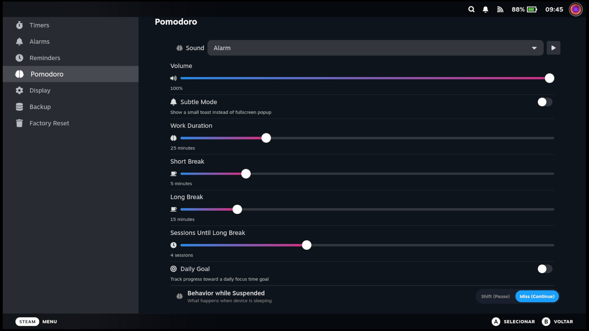
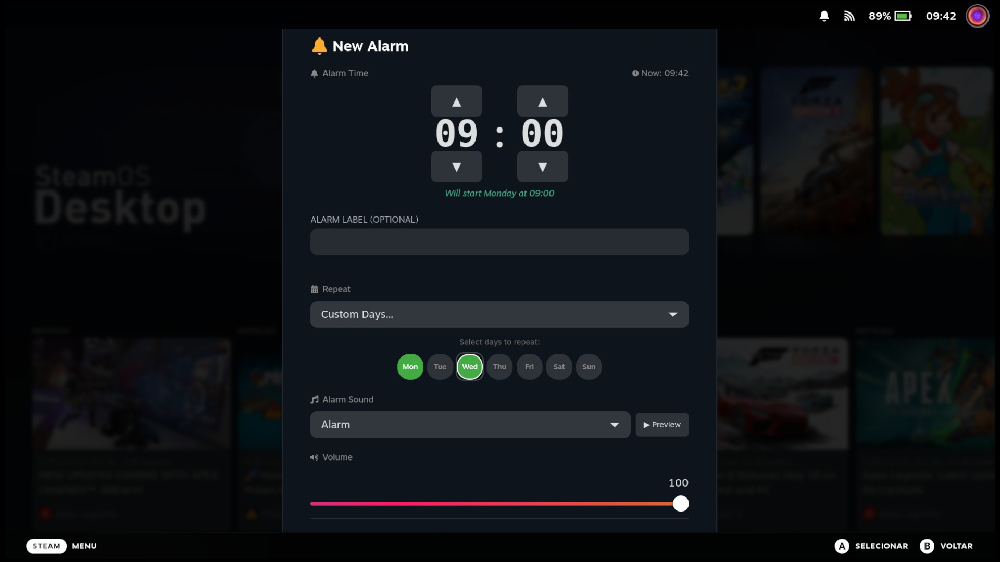
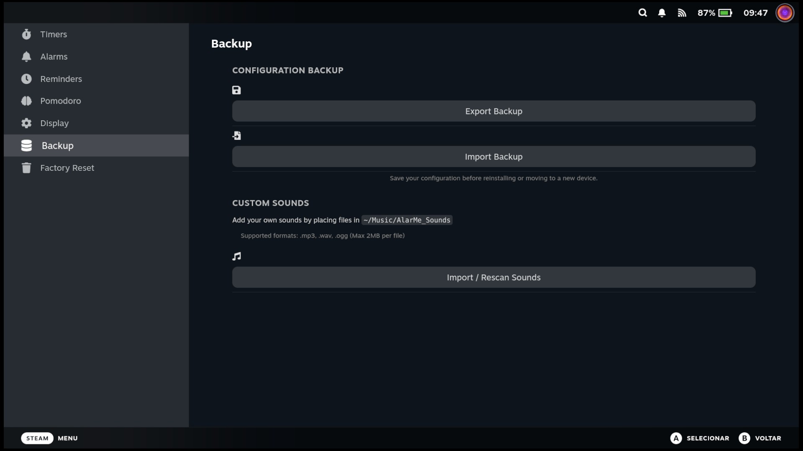
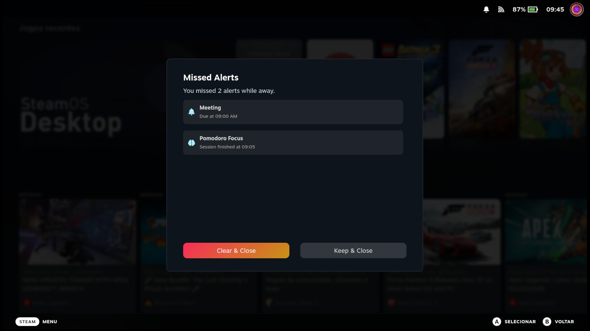

# Timeout - Decky Loader Plugin

Play-time discipline, focus with teeth, and optional parental lockout for Steam Deck.


## Features

### ⏳ Timers
- **Multiple concurrent timers** - Run several timers at once
- **Saved presets** - Save any timer as a custom preset, manage your list, and start timers with one click
- **Custom labels** - Name your timers for easy identification
- **Recent timers** - Quick access to your last 5 used timers
- **Persistent** - Timers survive Decky Loader restarts
- **Auto-suspend** - Optionally suspend the device when timer completes

### 🔔 Alarms
- **Time-based alarms** - Set alarms for specific times
- **Intuitive time picker** - Easy hour/minute selection with arrow controls
- **Recurring patterns** - Once, Daily, Weekdays, Weekends
- **Snooze functionality** - Configurable snooze duration (1-30 minutes)
- **Per-alarm settings** - Individual subtle mode and auto-suspend options
- **Persistent** - Alarms survive device reboots

### 🍅 Focus (Pomodoro)
- **Focus mode** - Customizable work duration (15-60 minutes)
- **Break intervals** - Short breaks (3-15 min) and long breaks (10-45 min)
- **Session tracking** - Configurable sessions until long break (2-8)
- **Comprehensive Statistics** - Track daily and lifetime focus time, sessions, and cycles.
- **Visual progress** - See your focus progress at a glance
- **Skip controls** - Skip to break or back to work anytime
- **Background persistence** - Timer continues running even if you close the menu
- **Reset Stats** - Option to wipe your history and start fresh

### 🔊 Sound Options
- **Per-feature sounds** - Different sounds for Timers, Alarms, and Pomodoro
- **Soundless mode** - Silent alarm option for quiet notifications
- **Volume control** - Adjust alarm volume independently per feature
- **Custom sounds** - Import your own MP3, WAV, or OGG files from `~/Music/Timeout_Sounds`
- **Folder sync** - Rescan to add new sounds or remove deleted ones

### 🎮 In-Game Overlay
- **Easy check** - Quickly see your alarms and timers
- **Native Integration** - Fits seamlessly into SteamOS UI and renders above game content only when the HUD needs it, so QAM and plugin pages stay interactive while a game runs
- **Non-Intrusive** - Horizontal micro-alerts that won't block game UI
- **Pixel shift** - OLED burn-in protection that slowly orbits the overlay position

### 💤 Prevent Sleep
- **Keep awake** - Prevent the Steam Deck from sleeping while you have active timers, alarms, or Pomodoro sessions
- **Native inputs** - Uses native SteamOS input inhibition for seamless operation in Game Mode

### 💾 Data Management
- **Backup & Restore** - Export your settings, alarms, timers, and stats to a file.
- **Easy Migration** - Move your data between devices or restore after re-install.

### ⚙️ Settings
- **Subtle mode** - Choose between fullscreen alerts or small toasts
- **Auto-suspend** - Automatically suspend the device after alert (enables subtle mode)
- **24/12 hour format** - Choose your preferred time display
- **Global volume control** - Per-feature volume settings

> **Note**: The overlay appears when you open the Quick Access Menu (•••) or Steam Menu. It uses the empty black bar space reserved by SteamOS to display your upcoming alarms and timers without obstructing any interface elements.

## Roadmap

### Planned Features
- **Game Limits** - whitelist/blacklist game selection; global default limits plus per-game overrides; daily open budget (e.g. 3 opens/day) and/or per-session time cap (e.g. 20 min/open), midnight reset; half-opens (quit a session past a threshold to bank a partial open); optional cooldowns between sessions (compounding); time-of-day curfew (day-of-week aware, e.g. no play 12am–5am); one-time "5 more mins" concession so a curfew hit can save/finish.
- **Focus enforcement tiers** - loose / steady / strict escalation so Pomodoro focus has teeth.
- **Parental controls + passcode** - distinguish self-control mode from administrative lockout.

## Screenshots

<details>
<summary>📸 Click to view screenshots</summary>

> **Note**: Screenshots may be stale until re-shot for Timeout.

### 🔔 Alarms

*Manage multiple alarms with ease.*

### ⏱️ Quick Timers

*One-tap presets and custom timers.*

### 🍅 Pomodoro Focus

*Stay focused with the built-in Pomodoro timer.*


*Customize your pomodoro however you like. Daily focus time and stats available*

### 📝 Easy Configuration

*Detailed settings for every alarm.*

### ⚙️ Customizable Settings

*New dedicated Settings Modal with Sound Manager and Backup options.*

### 🚨 Missed Alerts

*See what you missed while your Deck was asleep.*

</details>

## Installation

### From Decky Store
1. Open Decky Loader on your Steam Deck
2. Go to the Store tab
3. Search for **Timeout** in the Decky store (coming soon — use manual install below for now).

### Manual Installation
1. Download the latest release from the [Releases](https://github.com/Lakeland97/timeout-decky-plugin/releases) page
2. Open Decky Loader > Settings > General > "Install from Zip" > Select the Zip release file (not source code!).
3. Restart Decky Loader

## Adding Custom Sounds

1. Go to Desktop Mode.
2. Create a folder named `Timeout_Sounds` in your Music folder (`~/Music/Timeout_Sounds`).
3. Place your sound files (`.mp3`, `.wav`, or `.ogg`, max 2MB) in this folder.
4. Return to Gaming Mode > Timeout > Settings.
5. Scroll down to "**Custom Sounds**" and click "**Import Sounds**".
6. Your sounds will now appear in the sound picker lists!

## Development

### Prerequisites

```bash
# Install Node.js 18+
curl -fsSL https://deb.nodesource.com/setup_18.x | sudo -E bash -
sudo apt-get install -y nodejs

# Install pnpm v9
sudo npm install -g pnpm@9

# Verify
node --version  # Should be 18.x+
pnpm --version  # Should be 9.x
```

### Building

```bash
# Install dependencies
pnpm install

# Build for production
pnpm run build

# Watch mode for development
pnpm run watch
```

### Deploying to Steam Deck

1. Enable SSH on your Steam Deck (Desktop Mode)
2. Deploy:
   ```bash
   ./deploy.sh 192.168.X.X
   ```

### CEF Debugging

1. Enable "Allow Remote CEF Debugging" in Decky Developer Settings
2. Open Chrome/Edge and go to `chrome://inspect`
3. Configure network target: `DECK_IP:8081`
4. Select "SharedJSContext" to debug

## Privacy

- All settings, alarms, timers, and related data stay on your device.
- There is no analytics, telemetry, or user tracking.

## License

BSD-3-Clause License - See [LICENSE](LICENSE) for details.

## Credits

- **Author**: Lakeland97
- **Based on**: [AlarMe](https://github.com/lemossilva/alarme-decky-plugin) by Guilherme Lemos
- **Inspiration**: [simple-timer](https://github.com/decktools-xyz/simple-timer)
- **Framework**: [Decky Loader](https://github.com/SteamDeckHomebrew/decky-loader)
- **Icons**: [React Icons](https://react-icons.github.io/react-icons/)

## Support

If you encounter any issues, please [open an issue](https://github.com/Lakeland97/timeout-decky-plugin/issues) on GitHub.


